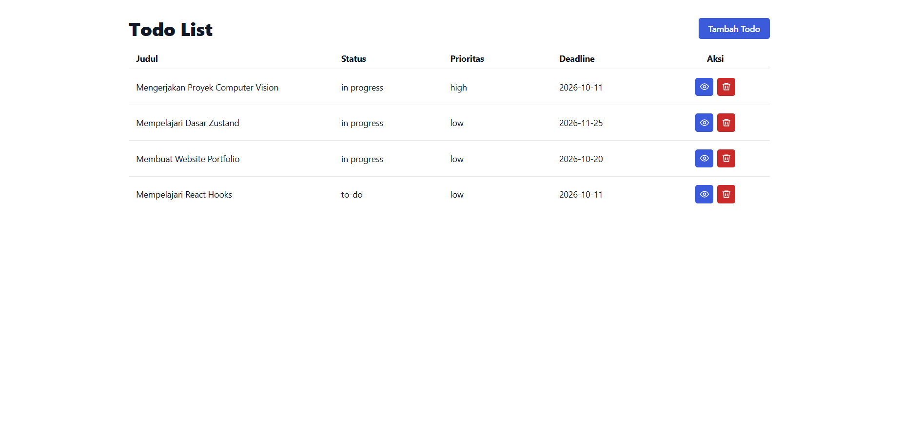
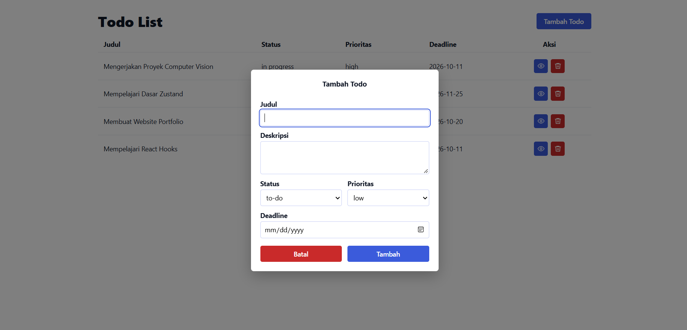
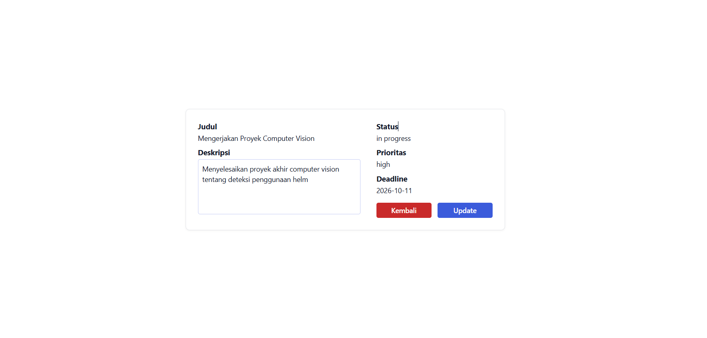
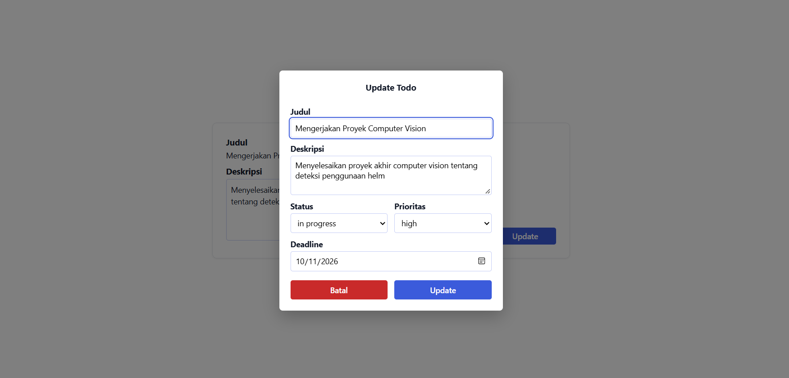
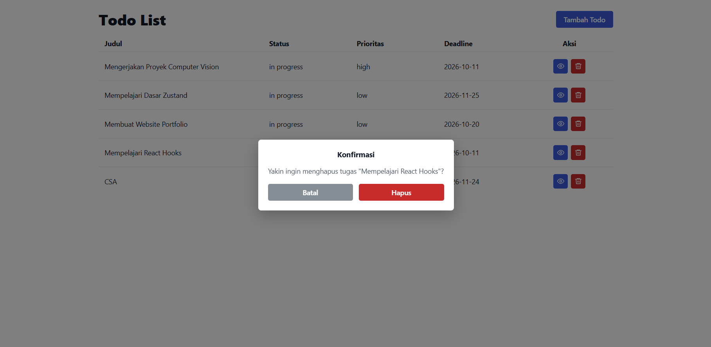

# Todo List - React.js

Aplikasi To-Do List frontend menggunakan React.js (Vite) dengan data dummy dan React State.

## Fitur
- Menampilkan daftar tugas
- Melihat detail tugas
- Menambah tugas
- Memperbarui tugas
- Menghapus tugas (dengan konfirmasi)

## Struktur Data
```js
{ id, title, description, priority, deadline, status }
```

## Cara Menjalankan
```bash
npm install
npm run dev
```
Buka http://localhost:5173

## Screenshot

### Daftar Todo


### Tambah Todo


### Detail Todo


### Update Todo


### Konfirmasi Hapus
